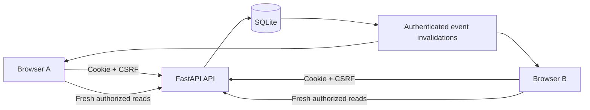

# Engineering decisions

## Architecture

One same-origin FastAPI application serves the UI and API. SQLite uses foreign keys, WAL mode, busy timeouts, parameterized queries, and explicit `BEGIN IMMEDIATE` transactions for state changes. This keeps relationship changes, notifications, and message persistence atomic within one database. No database or relationship state lives in browser storage.

The browser uses native modules and semantic HTML. Branding is original SVG with connected circles. CSS defines the requested lavender, rose, plum, white and semantic state tokens. The UI has desktop side navigation and a single bottom navigation on mobile, visible focus, reduced-motion support, loading/error/empty states, and explicit retry controls.

## Dating-first navigation

The five primary destinations are Feed (`/feed`), Discover (`/discover`), Matches (`/matches`), Inbox (`/chats`), and Profile (`/profile`). Matches always selects accepted dating relationships, independent of the previous friendship/study view; one-sided likes never enter that list. Friendship/study connections remain at `/connections`, with Received, Sent, Friends and Study views selected through a validated `view` query parameter. Their request badge appears on the secondary entry point rather than implying a dating match. Both areas mark Matches as the active primary destination.

Discover defaults to Dating. Its secondary categories use a validated `mode` query parameter, so refresh and Back/Forward reproduce the chosen category. The legacy `/dating` entry opens canonical Dating discovery. Main navigation back to Discover resets to Dating. Discovery and connection tabs expose selected state, labelled panels and arrow/Home/End keyboard navigation. Route changes focus the main content; dialogs use native focus restoration. Profile section links focus and scroll to existing editor nodes without rebuilding them or discarding drafts. Direct profile hashes are resolved after initialization.

Connections, Inbox, private requests and notifications refresh independently using settled requests. Successful lists remain usable if another request fails. Initial errors receive explicit retry states; an unsuccessful refresh of cached data keeps the last list with a warning. A failed history read preserves the per-conversation draft and offers Retry messages. Authorized catch-up on reconnection can restore the composer and its optional dating starters. Existing conversation permissions and message idempotency remain enforced. Schema version 5 adds the social and delivery-cursor tables.

## Light and dark themes

An external `theme.js` script runs before the stylesheets, under the existing same-origin CSP, to apply the preferred theme before the app renders. Only `light` and `dark` are accepted from the `campuslink-theme` browser preference. With no saved choice it follows `prefers-color-scheme`, including system changes. A manual choice persists in local storage and synchronizes between tabs on the same origin. If storage is unavailable, the toggle remains usable in the current page. This preference stores no account or conversation data.

The header button is a native keyboard-operable button with a stable “Dark theme” label, `aria-pressed`, an action tooltip and a 44px target. Changing themes updates the root attribute, button state and browser theme color without re-rendering routes, forms or the composer. New route headers read the current root state. `theme.css` supplies the dark palette, native control color scheme and component overrides, including readable text on primary buttons, selected navigation, dating labels and message bubbles. Photo colors are unchanged. No API or schema change is needed.

## Profile photos

Each account may keep four optional photos. The first gallery item is the main photo; students can preview uploads, replace images, reorder them, choose a main photo, and remove images without uploading any photo during onboarding. Profile text and photo edits save independently, preserving unsaved text while photo actions complete.

Schema version 2 adds `profile_photos` through the existing idempotent SQLite initialization. Processed JPEG bytes are stored as private SQLite BLOBs, with separate ordering/version metadata in the same rows. This keeps image replacement, ordering, and account-deletion cascades transactional and avoids orphaned files or a public uploads directory. Restarts retain both the image and its metadata. Removed images are deleted from the active database; backup/WAL retention follows the existing deferred retention policy.

Uploads are raw binary bodies, authenticated with the session cookie and CSRF token. There is no multipart dependency. The server bounds both declared and streamed bodies to 8 MB for upload/replace routes while preserving the 32 KB limit on JSON writes. An upload is decoded from its contents, not trusted from its filename or MIME label. JPEG, PNG, and still WebP are supported; animations, SVG, corrupt files, images below 200 pixels on either side, images above 20 megapixels, and sides above 10,000 pixels are rejected. HEIC is not supported in this phase.

Pillow verifies and decodes the upload, corrects EXIF orientation, resizes to fit 1200 × 1200 pixels, flattens transparency on white, and writes a fresh JPEG without EXIF/GPS, XMP, comments, or ICC metadata. Stored images are bounded to 768 KB. At most two decoding jobs run concurrently per process; uploads are limited to 20 attempts per minute per account. The approach follows the official [Pillow image verification](https://pillow.readthedocs.io/en/stable/reference/Image.html#PIL.Image.Image.verify) and [metadata/security guidance](https://pillow.readthedocs.io/en/stable/handbook/security.html).

Gallery URLs use authenticated `/api/photos/{id}` reads with `Cache-Control: no-store`. Every read checks active account state and the same policy as full profile lookup: owner access, legitimate eligible discovery within the institution, or an active accepted connection, with both-direction blocking overriding access. Dating-only visibility depends on reciprocal adult eligibility and preferences. No original upload or upload hash is exposed. Image versions change the URL after replacement so avatars refresh promptly.

Client upload keys and source hashes make retries idempotent for both creation and replacement. The gallery cap and ownership checks are repeated inside a write transaction after processing. Photo changes emit generic invalidations to the owner and accepted peers; current chat avatars refresh without rebuilding the composer or losing drafts.

## Personality prompts

Schema version 3 adds `profile_prompts` without altering existing accounts, photos or sessions. Each student may save zero to three optional answers from the server-owned catalog at `/api/catalog`. Questions use stable IDs; displayed wording comes from the catalog. Answers are trimmed plain text, bounded to 280 characters, with distinct question IDs and contiguous ordering. Empty answers, unsupported questions, duplicate questions, malformed text and oversized sets are rejected before changing saved data.

The authenticated, CSRF-protected `PUT /api/me/prompts` replaces the owner's entire ordered set in one SQLite write transaction. Repeating the same save does not duplicate answers. Concurrent saves commit complete sets; the last committed set wins. Removal is saved by omitting an answer, and an empty list clears the set. Account deletion cascades to answers; deactivation retains them behind the existing account visibility policy.

Answers are part of the normal authorized profile projection, including friendship/study profiles and eligible Dating profiles. They have no separate public read endpoint. Compact discovery cards open the full profile through the photo or name; all answers appear there in order. Profile visibility, institution scope, reciprocal dating eligibility, accepted-connection exceptions, suspension and both-direction blocks apply through the existing profile/discovery/connection authorization. Answers are escaped as text in selects, textareas, cards and dialogs. Generic refresh events contain no answer text.

The editor lives in Profile and saves separately from profile text and photos. Editing, question changes, reordering and removal remain unsaved until **Save answers**. A failed save retains the draft and offers retry. Drafts live only in memory for the signed-in account within the current tab, survive in-app navigation and sibling profile/photo saves, and clear on reload or account switch. Prompt saves merge only prompt fields into client state, preserving unrelated edits and chat drafts. The optional editor does not add a required onboarding step.

## Dating intentions

Schema version 4 adds one optional `dating_intentions` row per account without altering existing users, sessions, photos or prompt answers. Stable IDs and labels come from the server catalog. The only choices are `relationship`, `getting_to_know`, and `figuring_out`; the separate display flag defaults to false. Absence of a row means unset. `PATCH /api/me` validates the choice and boolean display flag alongside the existing profile changes in the same transaction. Invalid settings roll back all changes. Removing the choice deletes its row and clears sharing; hiding retains the private choice. Unrelated profile saves preserve both fields. Neither choosing nor displaying an intention activates Dating. Account deletion cascades to the row; deactivation hides the account and retains it.

Self responses include the private choice and display setting. General public profile serialization excludes both fields. Authorized Dating serialization adds the choice and catalog label only when displayed. Discovery does this only in Dating mode, and connection/chat responses do this only for active dating relationships. Their friendship/study rows omit intentions even when the same pair also has a dating match.

Full-profile requests carry a `context` of `general` (default), `friend`, `study`, or `dating`. Dating context independently requires eligible Dating discovery or an authorized active dating match; an accepted friendship does not grant this access. General/friend/study contexts return the general projection. The browser carries the context from dating cards, connection kinds and chat kinds, rather than inferring it from the current discovery tab. These checks prevent a forged context from disclosing an intention through friendship-only access. Blocks and revoked eligibility/consent still override Dating access.

An optional `intention` filter is accepted only in Dating and matches the already authorized, displayed choice before ranking/pagination. Hidden choices are never used as filter input. With no filter, hidden and unset choices remain eligible under the ordinary discovery rules. Invalid IDs and intention filters in friendship/study modes return 422. The filter does not change match compatibility or conversation authorization. The editor and filter share catalog labels, the interface disables sharing when unset, and switching discovery categories clears the filter. Changes emit generic profile invalidations without intention contents; active chat drafts survive refreshes.

## Identity, eligibility, and privacy

Internal IDs are UUIDs; usernames are case-normalized with a unique database constraint. Passwords use salted scrypt. Only hashed random session tokens are stored; cookies are HttpOnly, SameSite=Lax, and Secure over HTTPS. Sessions last seven days. Authenticated writes require the session CSRF token. Unsafe cross-origin requests are rejected. Same-origin assets have a restrictive CSP, no external fonts, no analytics, and no location access.

`LocalEligibility` is the replacement boundary for a legitimate verification provider. Registration is explicitly for local testing. Adult fixture access can be assigned by the seed; created local accounts can also declare 18+ test access through the authenticated, CSRF-protected `/api/dating/test-eligibility` route using a private birth date and explicit local test acknowledgement. That route rejects under-18 dates, is rate limited, and never activates Dating or sets verified status. Generic profile updates cannot set eligibility flags. This self-declaration exists because real verification was deferred for local testing; it is not age verification. All returned profiles have `verified: false`. Age is evaluated in Africa/Lusaka. Only local mode and access-controlled staging can run. Public/production modes refuse startup.

The public profile projection excludes email, birth date, authentication data, role, dating preferences, and private eligibility metadata. Discovery is restricted to the initial institution, with an institution table and foreign key for expansion. Turning discoverability off stops new exposure, profile lookup by strangers, and incoming new requests. An accepted connection is the documented exception for profile lookup. Blocks in either direction override this exception.

## Discovery

Eligibility, active state, discoverability, both-direction blocking, category goals, dating reciprocity, existing pending/accepted connections, likes already sent, and dismissal cooldowns are checked before scoring or pagination. For You combines friendship and study opportunities; dating is excluded from that view. Returned action categories are those the student can legitimately request.

Rule weights live in `campuslink/app.py` as `WEIGHTS`:

| Signal | Weight |
| --- | ---: |
| Shared interest | 3 each |
| Same academic program | 4 |
| Available shared connection goal | 2 each |
| Shared study subject | 5 each |
| Shared study skill | 3 each |
| Shared learning goal | 3 each |

Subjects, skills and learning goals use normalized, case-folded comma-delimited phrases for the first version. Personal interests use normalized relational records. Ties use display name then immutable ID. Scores are ranking aids; the UI shows explanations rather than scientific compatibility percentages. Few-overlap students still receive eligible campus fallbacks.

Search supports display name, username, program, interest, and year, with 300ms debounce, at most 12 profiles per page, and bounded pages and inputs. Dismissals and declined requests have a 30-day cooldown. Cancelled/removed connections may be requested again with new consent. The first version filters and ranks the institution cohort in application memory; larger campuses need indexed candidate retrieval and load testing.

## Connections and dating

Dating is the first Discover view and has a direct `/dating` entry. Before activation it shows a setup introduction rather than fetching dating profiles. Created accounts first declare local 18+ test eligibility; eligible accounts then explicitly opt in and choose preferences in a separate step. The setup also permits switching to a labelled fictional adult fixture; that action rotates this browser's session without granting eligibility to the original account. Three dedicated fictional dating fixtures are seeded with opt-in enabled. No existing account is automatically activated, and no likes or matches are fabricated. Dating profile results expose calculated adult age but never the birth date or private preferences.

An unordered pair has one relationship per category, enforced by a unique constraint. Concurrent crossing friendship/study requests become one accepted relationship. Repeated same-direction requests return the existing pending request. Only the recipient can accept or decline; only the sender can cancel. Both accepted participants may remove.

Friendship, study, and dating relationships are independent. Dating interest remains in a separate table. The current UI’s public-like endpoint atomically adds a public profile reaction and Dating interest; only a reciprocal Dating interest creates a match. The legacy private endpoint remains private, and earlier private interests are never backfilled into public likes. Private comment requests provide an explicit recipient-acceptance path to a conversation. Mutual adult eligibility, explicit activation, reciprocal gender preferences, reciprocal age ranges, discoverability, and blocks are checked on each like. Repeated mutual likes do not duplicate matches. Unmatching and blocking clear both private likes. Disabling dating immediately terminates existing dating matches and clears likes; re-enabling cannot restore them automatically. Preferences that cease to be reciprocal also deny dating messaging access while incompatible.

## Messaging reliability and authorization

Conversation ID equals relationship ID. Every history read, send, and read-cursor update checks participant membership, accepted relationship state, active accounts, blocks, and dating eligibility when relevant. Inbox previews use the same permission check. Guessing another conversation ID returns 404. Removed or blocked relationships deny history and sends.

Messages are ordered by an immutable increasing database ID, with 50-message cursor pages. Text is bounded to 4,000 characters and escaped in the UI. The unique `(relationship_id, sender_id, client_id)` key ensures that retrying an interrupted request cannot duplicate a message. Reusing a key with different text is rejected. A committed outgoing message is **Sent**. A signed-in receiving browser acknowledges receipt to advance **Delivered**, including an inbox preview while away from that conversation. The visible conversation at its latest messages advances **Read**. Delivery/read endpoints authenticate membership and current consent, validate the cursor belongs to the conversation, advance monotonically and emit invalidations only on advancement. Read also advances delivery. Receipts persist across restarts; old read cursors imply delivery. Unread counts use monotonic per-user message cursors. Private message contents are never included in notification previews.

Server-Sent Events transport only user-scoped invalidations, never message bodies, conversation IDs, private likes, or arbitrary subscriptions. Each loop rechecks the session/account. The browser then fetches current data through authorized API routes. The initial/reconnected event triggers a full inbox refresh, and missed messages are caught up with the ordered message cursor. A 15-second foreground polling fallback and window-online/visibility refresh handle interrupted streams. SSE connection attempts are rate limited; heartbeats occur every 15 seconds. SQLite-backed events support multiple server processes on one host, but this has not been load tested.

Message updates do not rebuild the composer. Drafts and unacknowledged client keys remain in memory across updates and network interruption within the current page. They are deliberately not saved to persistent browser storage; an unsent draft is lost on full browser refresh. Server-acknowledged messages survive restarts. Run Uvicorn with a bounded graceful-shutdown timeout so long-lived streams do not hold a restart open.

## Conversation layout and progressive profile disclosure

Discovery cards retain the photo/initials cover, name, Dating age, program, public-like count and actions. Profile details are fetched through the existing authorized full-profile route when a photo or name is selected. Match avatars, the chat header and incoming group avatars carry the actual relationship kind into that request. General/Friends/Study contexts still omit Dating intentions; the backend remains the privacy boundary. Campus context is a separate general profile projection for posts/reactions and never exposes Dating intentions.

The message log groups adjacent messages from one sender within five minutes on the same Africa/Lusaka calendar day. Saved IDs remain the deduplication/render key. Date separators, times at group ends and one incoming avatar per group reduce repetition. Reporting is available through the optional safety footer, whose report dialog can select an already-loaded received message. The selected message ID is submitted through the existing report endpoint, which independently validates its sender and participant access. The existing match-removal endpoint is also reachable through chat options.

Phone chat regions follow the visual viewport height/offset above the main navigation; general headings/top bars leave space. The composer resizes independently, touch-device Return inserts newlines and desktop Enter retains sending. Reading older history preserves scroll position when messages arrive; a New messages button returns to the bottom. Explicit sending and opening a conversation still scroll to the latest. The existing idempotency keys, SSE invalidations, independent retries, in-memory drafts and permission checks are unchanged. Native keyboard/device behavior still requires physical-phone acceptance.

## Optional chat safety controls

As of 25 October 2026, Report and Block are inside a native details disclosure below the composer. It begins closed for each opened conversation. Neither opening the disclosure, selecting Report nor opening/cancelling the block confirmation writes a report or block. Report submission and the final block confirmation retain their existing server endpoints and authorization. The header menu links to this footer rather than duplicating the actions; full-profile safety choices are also collapsed. The per-message ellipsis/report buttons are removed.

The report dialog defaults to profile/conversation reporting and optionally offers received messages already loaded for that active conversation. Message snippets are normalized, shortened and HTML-escaped; only the selected numeric message ID is submitted. The backend continues to validate every report. Cancelling keeps the composer draft. Footer height participates in the New messages button offset, and the expanded footer has a bounded scroll area for small viewports. No database or API migration is needed.

## Conversation starters

`GET /api/chats/{rid}/starters` authenticates the viewer, applies the ordinary active-relationship authorization, and additionally requires a dating relationship. A visible dating profile or a one-sided like is insufficient. Friendship/study connections, unrelated viewers, revoked matches, blocks, unavailable accounts, and incompatible Dating preferences cannot use this endpoint. Existing accepted matches may still use it when campus discovery is off, consistently with message access.

The endpoint generates three suggestions locally from deterministic templates: a shared interest, the other participant's currently visible prompt answer when available, then additional interest/answer or campus questions. It uses the existing authorized profile projection and never includes private intentions, contact details, dates of birth, preferences, or conversation history. Quoted answers have whitespace normalized and are bounded to a 96-character excerpt. Responses use the API's `Cache-Control: no-store`. Reads do not create messages, notifications or read cursors. No schema change or stored suggestion records are needed.

The browser mounts a separate panel inside the dating chat layout, outside the composer and message log. All conversations start with it collapsed unless the student chose otherwise in this tab. Panel expansion is remembered per conversation in memory and cleared on reload or account switch. Suggestion loading can fail and retry independently of message history or sending. Current profile metadata invalidates the suggestions on the next authorized refresh, while message drafts remain intact. Request serials and teardown prevent late loads from appearing in another conversation or account.

Choosing a suggestion only fills the ordinary composer and dispatches its normal draft-input event. An existing nonempty draft is preserved with a clear instruction to empty it before choosing another starter. An unsent outbox message also prevents replacement. The student may edit a chosen question or write their own; only an explicit Send action (including the existing Enter shortcut) invokes the ordinary authenticated message endpoint and idempotent retry key. Starter text and source context are escaped when rendered, including HTML-looking text in a profile answer.

## Safety, moderation, and account lifecycle

Blocking is bidirectional across discovery, profile lookup, requests, dating and messaging. It ends all relationship categories. Unblocking does not restore consent. Reporting can refer to a profile or a message sent to the reporter, including a message retained after a block. Only the moderator role sees the queue; moderation decisions are appended to an audit table. Suspension revokes all sessions and hides the account. Reports are not exposed to the reported student.

Passwords can be changed with the current password; other sessions are revoked. Optional SMTP recovery issues 30-minute hashed one-use tokens, gives generic responses, and revokes every session on reset. SMTP failures do not change the recovery response. Email delivery is a background operation, not a durable delivery queue.

Account deletion requires the password and hard-deletes the user, sessions, interests, photos, prompt answers, blocks, likes, relationships, and their messages using foreign-key cascades. A conversation is deleted for both participants. Reports and moderation audits remain, with deleted user/message references set to null. Free-text report content may still contain personal information; a public retention/review process is required. Deactivation hides the account and revokes sessions; local operator assistance is required to reactivate.

Ended conversations stay in SQLite but cannot be read through the API. A fresh accepted request between the same pair/category reuses the relationship and can restore its retained history; this requires new mutual consent. This policy is disclosed in the UI. No production retention schedule, encrypted backups, disaster recovery, at-rest encryption, or end-to-end messaging encryption is claimed.

Rate limits persist in SQLite. Examples: 30 requests/hour, 90 sends/minute, 90 searches/minute, 10 reports/hour, 30 stream attempts/minute, with IP and account limits on login and recovery. The global IP cap is 600 API calls/minute. Proxy configuration and campus-wide shared IP effects need deployment-specific review.

## Campus posts and private inbox requests (schema 5)

`campuslink/social.py` registers routes using the same database/session/CSRF, eligibility and relationship authorization helpers. Posts are scoped to active, onboarded students in the same institution. Owners and active accepted connections retain the visibility exception; both-direction blocks override access, including direct post-photo reads. Reaction lists hide unavailable/blocked people. Post photo uploads share the existing bounded decoder/metadata stripping; pending uploads are owner-only, capped at four and purged after 24 hours on a later upload. Published image bytes remain private SQLite BLOBs. Publish transactions enforce ownership, one post per image and idempotency keys; content changes with a reused key are rejected. Caption edits are owner-only. Deletion removes the post, reactions and image; private request text remains with a null post reference. Account deletion cascades social records.

Profile/post reactions are public only to authorized campus viewers. A private comment creates one request for a sender/recipient pair, or returns their existing active conversation. Only the recipient can decide. Acceptance transactionally creates/reuses the consented relationship and inserts the original comment once, with a unique request-derived message key. Repeat acceptance returns the same conversation. A decline cannot be changed to acceptance by a retried or forged action. Incompatible/deactivated Dating or blocks deny acceptance/access. Existing friendship/study requests remain separate. No song links, external media players or third-party frame permissions are added.

## Shared-network request budgets

The general API budget is 600 requests per minute per active authenticated account, shared across that account’s sessions. Anonymous requests retain 600/minute per IP; a separate 6,000/minute IP ceiling bounds shared-network traffic. Identity for this bucket comes from a valid, unexpired session belonging to an active account. Cookie text alone never selects a user bucket. Route authentication, CSRF and action-specific limits still run independently. This prevents two campus-Wi-Fi users from sharing one small budget. Client conversation acknowledgements operate on the highest received message, not the sender’s own outgoing message; a Read acknowledgement also advances delivery, avoiding redundant writes/invalidations.

## Hosted preview

`Deployment.load` accepts local/staging configurations. Staging requires a separate absolute database path outside local `data/` and a canonical HTTPS origin. Render cannot start in local mode. The runtime URL supplies the origin when a custom one is absent. Supplied fixture databases and online seeding are refused. Student and adult eligibility remain explicitly unverified test declarations.

The 27 October update removes shared tester authentication entirely. Landing/auth pages, assets and the public catalog open directly. Private APIs, photos, notifications and SSE still call the existing account authentication and authorization checks. Basic headers and old tester cookies cannot grant account access; legacy tester environment variables are ignored. `/tester-access` redirects to `/` for old bookmarks. No shared cookie signing key, access form or frontend gate redirect remains.

The staging ASGI middleware retains canonical-host/HTTPS checks, no-store/no-index headers and HSTS. Individual Secure/HttpOnly sessions, CSRF, origin checks, consent, visibility and block rules remain enforced by the app. The minimal GET health probe can bypass host/HTTPS checks for platform liveness. Publicly reachable preview pages do not claim completed production eligibility or student acceptance.

`python -m campuslink.serve` starts one worker on the platform port with bounded shutdown and explicit proxy handling. Render ingress is trusted only on Render; other hosts default to loopback. The Blueprint attaches `/var/data` and disables automatic code deployments. No build/seed step touches the runtime database.

`python -m campuslink.backup DESTINATION` creates a mode-0600 consistent SQLite backup with integrity checking and overwrite/missing-source refusal. It includes sessions, messages and images. External copies and a hosted restore exercise remain necessary.
